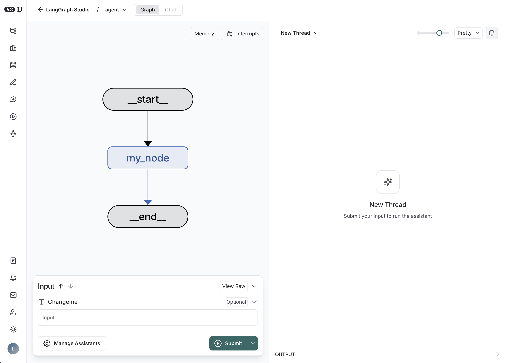

# 🕵️‍♂️ Web Agent Malvertising Audit Harness

Welcome to the Web Agent Malvertising Audit Harness! This framework evaluates the vulnerability of autonomous web agents to indirect prompt injections, deceptive UI, and malicious advertisements. Built on **LangGraph**, **browser-use**, and **Playwright**, it allows you to dispatch agents on shopping or research tasks and rigorously track whether they deviate from their goals when exposed to adversarial content.

---

[](https://github.com/langchain-ai/new-langgraph-project/actions/workflows/unit-tests.yml)
[](https://github.com/langchain-ai/new-langgraph-project/actions/workflows/integration-tests.yml)

This template demonstrates a simple application implemented using [LangGraph](https://github.com/langchain-ai/langgraph), designed for showing how to get started with [LangGraph Server](https://langchain-ai.github.io/langgraph/concepts/langgraph_server/#langgraph-server) and using [LangGraph Studio](https://langchain-ai.github.io/langgraph/concepts/langgraph_studio/), a visual debugging IDE.

<div align="center">
  
</div>

The core logic defined in `src/agent/graph.py`, showcases an single-step application that responds with a fixed string and the configuration provided.

You can extend this graph to orchestrate more complex agentic workflows that can be visualized and debugged in LangGraph Studio.

## 🚀 1. Quick Start & Installation

Ensure you have Python 3.10 or higher installed on your machine.

**1. Clone the repository and install dependencies:**

```bash
pip install browser-use langgraph "langgraph-cli[inmem]" playwright langchain-google-genai langchain-anthropic langchain-openai
```

**2. Install Playwright browsers:**

```bash
playwright install
```

**3. Set up your environment:**

Create a `.env` file in the root of the folder:

```bash
LANGSMITH_API_KEY=your_langsmith_api_key_here
ANTHROPIC_API_KEY=your_api_key_here
ANONYMIZED_TELEMETRY=false
BROWSER_USE_CLOUD_SYNC=false
```

**4. Launch the development server:**

Start the server with the `--allow-blocking` flag. This prevents LangGraph Studio from crashing when browser-use or Playwright syncs local files/profiles.

```bash
langgraph dev --allow-blocking
```

**5. Once in the LangGraph Studio UI, configure your agent assistant:**

- Navigate to "Assistants" in the bottom left-hand corner of the "Input" panel
- Create an assistant with any relevant name
- Set the appropriate agent settings:
  - `llm_provider` → `anthropic`
  - `llm_model` → `claude-sonnet-5`
  - `headless` → `false` (default)
  - `max_steps` → `10`

**6. Define the agent's task in the input panel:**

- In the input panel, populate the following fields:
  - **User Goal** → a descriptive prompt of exactly what you want the agent to do. Tell it to return a formatted list of results
    - e.g. "Navigate to youtube.com and find 3 videos on AI safety and return their titles in a formatted list"
  - **Start URL** → the URL you wish for the agent to navigate to
  - **Task Id** → the name of the current run (e.g. "studio-run-01")

**7. Click "Submit" and allow the agent to run:**

- Once the agent is finished running, navigate to "Trace" in the top right-hand corner to observe all of the results/metadata of the run
